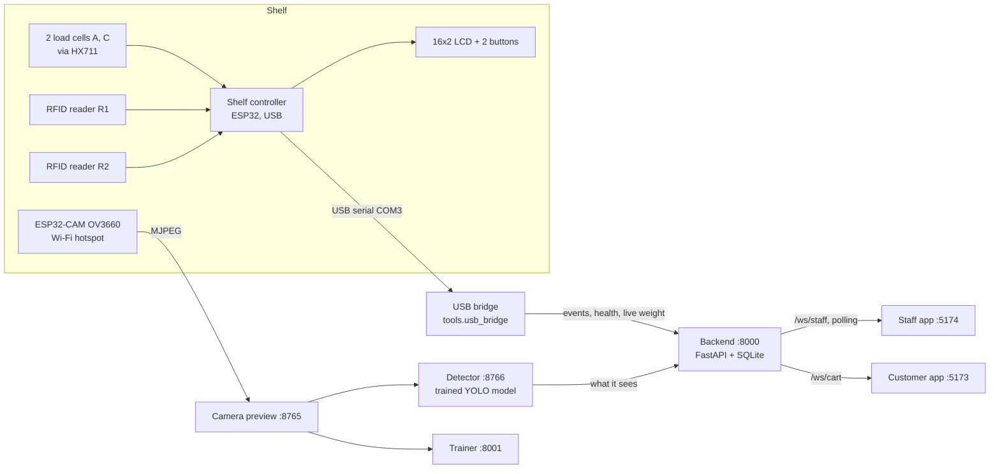

# ShelfFlow: how the system works

The current, end-to-end picture of the store as it runs on the laptop (27 October 2026). Detailed
topics have their own docs, linked at the end; where an older doc disagrees with this one, this one
is current.

ShelfFlow is a smart shelf: a customer checks in with an RFID bracelet, picks products off a weighed
tray watched by a camera, and leaves by tapping the bracelet at the exit, which produces the bill.
Staff see everything live and decide anything the shelf could not prove on its own. Payment is
simulated.

## 1. The pieces

| Piece | What it does | Where |
|---|---|---|
| Shelf controller (ESP32 #1) | Weighs the tray, reads both RFID readers, drives the LCD, stores every event on flash until the laptop confirms it | `firmware/shelf-controller`, build `devkitc-v4-usb-integration`, USB **COM3** |
| Load cells A and C | Two 10 kg cells under one mixed-product tray (`tray-a`) | [weighing-ac.md](weighing-ac.md) |
| RFID readers R1, R2 | Two RC522 readers on the controller. R1 is the check-in reader; both mark a shopper at the shelf; R2 is also the exit reader | [dual-rc522-and-38pin-programmer.md](dual-rc522-and-38pin-programmer.md) |
| Camera (ESP32-CAM, OV3660) | 320x240 at ~11 fps over Wi-Fi (hotspot "Yeti ", then "Pixel", "X200T"), MAC `68:09:47:F8:93:B8` | `firmware/camera`, [programming-camera.md](programming-camera.md) |
| Programmer (ESP32 #2, EN to GND) | Only a USB-serial adapter for flashing and reading the camera's log (**COM5** here) | `tools.camera_serial_log` |
| USB bridge | The only program that opens COM3: delivers controller events to the backend, forwards health and live weight, logs diagnostics | `tools/usb_bridge.py` |
| Backend | Database, all decisions (carts, stock, review, checkout), APIs and live sockets | `backend/` |
| Camera preview | Shares the one camera connection with everything else (raw frames) | `tools/camera_preview.py` :8765 |
| Detector preview | Runs the product model on the live frames; the backend reads its `/status` | `tools/detector_preview.py` :8766 |
| Trainer | Records clips, labels them, trains and switches models | `tools/trainer.py` :8001 |
| Staff app / customer app | React apps (Vite), HTTPS on the hotspot for phones | `apps/staff`, `apps/customer`, `apps/shared` |

All settings live in `data/integration/runtime.env` (section 9).

## 2. Starting everything

Order matters only loosely; everything retries. From the project folder:

| Service | Command | Port |
|---|---|---|
| Backend | `.venv\Scripts\python.exe -m tools.local_app backend` | 8000 |
| USB bridge | `.venv\Scripts\python.exe -m tools.usb_bridge --port COM3` | (serial) |
| Camera preview | `.venv\Scripts\python.exe -m tools.camera_preview --camera http://<camera IP>` | 8765 |
| Detector | `.venv\Scripts\python.exe -m tools.detector_preview` | 8766 |
| Trainer (when training) | `.venv\Scripts\python.exe -m tools.local_app trainer` | 8001 |
| Vision service (two shoppers) | `.venv\Scripts\python.exe -m tools.local_app vision` | (posts to backend) |
| Staff app (phones too) | in `apps/staff`: `node ../node_modules/vite/bin/vite.js --mode lan --port 5174 --strictPort` | 5174 |
| Customer app | in `apps/customer`: same with `--port 5173` | 5173 |
| Phone setup page | `.venv\Scripts\python.exe -m tools.demo_lan` | 5180 |

These are also in `.claude/launch.json`. `tools.demo_lan` prints the phone links and issues the HTTPS
certificate for the laptop's current address (from the same local CA, so phones that trusted it once
keep working; restart the two apps after it re-issues). Phones must be on the same hotspot and open
`https://<laptop IP>:5173` (customer) or `:5174` (staff). See [demo-offline.md](demo-offline.md).

Logins: staff password = `STAFF_PASSWORD` in `runtime.env`; customer accounts are created by staff
(Shoppers & checkout → Accounts & receipts). Passwords are stored only as hashes.

## 3. The customer's visit

1. **Entry code.** The customer signs in to the customer app and taps *Show my entry code* (single use,
   2 minutes).
2. **Check-in.** Staff (Shoppers & checkout → Check-in, or Front desk) scan the code, tap a free
   bracelet on **R1**, and press *Assign and start visit*. The backend refuses a bracelet that was not
   tapped on R1 in the last 2 minutes, is already in use, or has no pattern. A visit (`ShoppingSession`)
   becomes ACTIVE and a `BraceletBinding` links customer ↔ visit ↔ RFID UID ↔ pattern marker
   (Stripes = 200, Circles = 201).
3. **Shopping.** Each pickup or put-back changes the cart (section 5). The customer app updates live and
   shows a short notice per change; items still being checked show as "Checking N items".
4. **Checkout.** The customer taps **Checkout**. The app says: go to the exit, tap your bracelet on the
   exit reader (R2) and hand it over. *Keep shopping* cancels. The request lasts 15 minutes.
5. **Exit tap.** The R2 tap of that bracelet bills the visit as soon as nothing blocks it (an item waiting
   for staff review, a shelf event still being processed). The bill (receipt) appears in the app, the
   visit becomes COMPLETE and the bracelet is **released for the next customer at once**.
6. **Next visit.** *Bracelet handed over · Exit* on the bill screen opens the customer's next visit and
   shows a new entry code.

Staff can also check anyone out by hand (Shoppers & checkout → Visits & checkout); that bracelet then
waits until staff confirm it is back.

## 4. The shelf controller

- **Weighing** (`include/weighing_pipeline.h`, `hold_tracker.h`): both cells are read at ~10 Hz,
  filtered and converted with the saved calibration (`ac2-167a4d-8q`). The *hold tracker* keeps the last
  settled weight and re-tares slow drift away every 2 s; a settled change of 3 g or more is an item
  placed or removed. Each new held weight is **rounded to whole grams**; an empty tray snaps to exactly 0.
- **Events.** A settled step becomes a `WEIGHT` event (pre and post weight); a tap becomes an `RFID`
  event (UID and reader); every 2 s a best-effort `HEALTH` report carries the live and held weight.
  `WEIGHT`/`RFID` events are written to flash first and deleted only after the laptop acknowledges
  them, so nothing is lost while the laptop is off.
- **Tare.** The `tare` command (or the buttons) sets the current load to **exactly 0** at once. A manual
  tare is not saved across a restart; after any restart the controller treats what is on the tray as 0.
- **RFID.** One task alternates the two readers' fields. A tap is reported once per presentation. A
  **watchdog** restarts the scan if it stops for 5 s (then restarts the controller if that fails), and
  resets readers that stop answering or hear nothing for 2 minutes. Status line:
  `DIAG RFID_QUEUE ... beat_ms reinits restarts`.
- **LCD.** Shows the tray weight like the staff screens (held whole grams while still). The laptop can
  put guidance on it (`lcd <seconds> <line1>|<line2>`, `#` = live weight), used by tray loading.
- **Lost-event counter.** The controller counts every event it ever lost and keeps the count across
  restarts (67 from old bench tests), which makes every report say `ok: false`. The backend accepts a
  known count (`SENSOR_ACCEPTED_OVERFLOW`); a new loss is refused again.

Flashing: `pio run -e devkitc-v4-usb-integration -t upload --upload-port COM3` from
`firmware/shelf-controller` (stop the bridge first). Host tests: `firmware/shelf-controller/tests/*.cpp`.

## 5. Whose cart, and which product

Three attribution modes (`CART_ATTRIBUTION`). **hybrid is in use now**: the rfid rules below while one
shopper is at the shelf, the camera rules when two or more are.

**rfid**, `backend/shelf_cart.py`. One shopper at the shelf at a time.

- **Who.** The shopper whose bracelet was last tapped on R1 or R2 after check-in, or who checked in most
  recently, within `SHELF_PRESENCE_S` (300 s). Another shopper's tap takes over. A shopper who pressed
  Checkout no longer counts.
- **When.** Every settled weight step of 5 g or more: down = pickup, up = put back. Steps during an open
  tray-loading session are stock, not shopping.
- **What.** On a tray with weighed units, the units whose weights add up to the change (the camera breaks
  a tie and must not contradict). Otherwise the product the camera stopped seeing (pickup) or started
  seeing (put back) since the tray's previous step; the backend samples the detector twice a second for
  this (`backend/camera_watch.py`), checked against the product's unit weight when one is set.
- **Result.** All checks pass and `AUTO_ADD=true`: the cart and stock change at once. Anything unproven
  becomes a **Review queue** item with shopper and product filled in, for example *No shopper at shelf*,
  *Camera wasn't watching*, *Weight fits no item*, *Put back, but not in this shopper's basket*.

**camera**: the vision service (`tools.local_app vision`) sends one INTERACTION event per moved item. The
trained model's bracelet bands (`band-stripe` = marker 200, `band-circle` = 201) mark each wrist; the area
around a band is that hand; the item it moved belongs to that bracelet's visit. The backend charges only when
every check passes ([shop-workflow.md](shop-workflow.md) sections 2–3). On a per-item tray with nothing
weighed in, the camera names the product and the weight only has to agree on the direction.

**hybrid** (in use): the camera confirms a bracelet when it sees the same pattern in `band_confirm_frames` (5)
frames in a row; that opens the camera window, which stays open until the scale reports the pickup (up to
`max_collection_seconds`, 15 s), so the clip runs from the bracelet to the item leaving. The weight change goes
to the customer whose bracelet was confirmed nearest in time (20 s before to 5 s after; one change per
confirmation), with one shopper at the shelf or several. The product is what the camera saw leave between
just before the bracelet appeared and after the weight change (or the weighed units). All checks pass: straight
into the cart. No bracelet seen: one shopper is decided by the tap/check-in; several wait 35 s, then Review.

Each shelf weight event can be used once, so nothing is charged twice.

## 6. Stock

- **Weighed units** (`TrayUnit`): tray loading (Stock → Load the tray) weighs each item as it is
  placed, with a before/after photo. A unit is ON_TRAY, IN_CART (a visit holds it), or REMOVED.
- **Camera stock**: products without weighed units count as 1 in stock while the camera saw them in the
  last 6 s.
- The Stock page shows weighed units where they exist, otherwise the camera.
- Review choices keep stock true to the scale: **Left the tray, nobody charged** (a pickup nobody pays for:
  the unit is removed) and **Put on the tray as stock** (an item added that no cart holds: a new weighed
  unit). *Not a real movement* leaves stock unchanged.
- Tray-loading photos are original camera frames; the detector turns each item's before/after pair into a
  product reference (*Look learned*). An item cut off at the edge of the camera view is refused; place
  items in the middle or front while loading.

## 7. Staff app

| Page | For |
|---|---|
| Front desk | Check in, who is in the store, who is at the exit |
| Home | Camera, shelf controller, review count, shoppers, live tray weight |
| Live camera | The detector view or the raw camera, what it sees, the tray weight |
| Review queue | Every item the shelf could not prove: pick product and shopper, then Record, or one of the stock choices |
| Shoppers & checkout | Check-in and bracelets, visits and checkout, customer accounts and receipts |
| Stock | Products on the shelf, tray loading |
| Products & training | Catalogue and photos, **Train with video**, photo references, camera questions |
| Insights, Shelf setup | History and drift; calibration, tray regions, loading |

Live updates: the staff app keeps a WebSocket (`/ws/staff`) that pushes the tray weight about once a
second and a *changed* signal after every committed cart, review or shelf event, so the page reloads at
once; polling every 2 s remains as the fallback. The customer app uses `/ws/cart`.

## 8. Recognition and training

- **Detector.** With `models/trained/active.pt` present it runs that YOLO model, whose classes are the
  product IDs (and the bracelet bands `band-stripe`, `band-circle`, which are never products). It follows
  the active model automatically. Without one it falls back to the pilot item detector + photo gallery.
- **Recording** (Products & training → Train with video): pick what you are recording (a product, a
  bracelet band, or the empty tray), record up to 120 s, mark the object once; SAM 2.1 tracks it through
  the clip. Review frames and exclude bad ones.
- **Training.** Choose the recordings and the model to build on. The new model keeps every class its
  parent knew. The parent also labels the other products it clearly sees in new clips (score ≥ 0.7), so
  products sitting on the tray during a band clip are not learned as background, and leaves out frames
  whose tracked box jumped onto a different product (SAM loses a band when the hand leaves the view and
  can latch onto the jar next to it). Images are cached in
  RAM; on Windows no extra loader processes are started.
- **Switching.** Test a new model on the live view with products and a band in view before switching
  it on; switch back to an earlier run from the run list at any time.

Details: [training.md](training.md), [model-pipeline.md](model-pipeline.md), [recognition.md](recognition.md).

## 9. Settings (`data/integration/runtime.env`)

| Key | Now | Meaning |
|---|---|---|
| `SHELFFLOW_MODE` | hardware | `simulation` for the simulator |
| `WEIGHTS_ENABLED` | true | Shelf weight drives carts and stock (false = staff-counted assisted mode) |
| `AUTO_ADD` | true | Proven pickups change the cart without staff |
| `CART_ATTRIBUTION` | hybrid | `rfid` (last tap), `camera` (bracelet at the hand) or `hybrid` (rfid alone, camera for two) |
| `SHELF_PRESENCE_S` | 300 (default) | How long a tap or check-in keeps a shopper at the shelf |
| `SENSOR_ACCEPTED_OVERFLOW` | 67 | Controller lost-event count accepted as history |
| `RFID_ENTRY_READER` / `RFID_EXIT_READER` | R1 / R2 (default) | Check-in reader / exit reader |
| `CAMERA_URL` | http://127.0.0.1:8766 | Detector the backend reads |
| `PHYSICAL_CAMERA_URL` | http://10.33.1.251 | The camera itself |
| `DATABASE_URL`, `EVIDENCE_ROOT`, `USB_EVENT_ROOT` | data/integration/... | Where things are stored |

Restart the backend after changing it.

## 10. Where the data lives (not in git)

| Path | Contents |
|---|---|
| `data/integration/store.db` | The store database (visits, carts, events, stock, audit log) |
| `data/integration/runtime.env` | Settings and secrets |
| `data/integration/usb/` | Bridge status, delivered events, `rfid-diagnostics.jsonl` (weights and reader counters, 1/s) |
| `evidence/`, `evidence/catalogue/` | Event clips; product and tray-loading photos |
| `models/`, `models/trained/` | Detector weights; the active trained model |
| `data/training/sessions`, `runs` | Training recordings and runs |
| `data/hardware-backups/` | Firmware and measurement backups |

Every decision (check-in, review, correction, checkout, bracelet release, stock change) is in the
audit log (`audit_records`).

## 11. When something is wrong

| Symptom | Check |
|---|---|
| Camera offline | Does it answer on the hotspot? Read its log through the programmer (`tools.camera_serial_log --port COM5`); a brownout loop means its 5 V supply sags: own short wires from the supply, 100 µF at its pins |
| RFID taps not registering | `DIAG RFID_READERS` counters in `data/integration/usb/rfid-diagnostics.jsonl`; the watchdog should recover; otherwise restart the controller |
| Pickup not added to a cart | Review queue: the reasons say why (no tap recently, camera, weight) |
| Stock wrong | Review history; *Left the tray* / *Put on the tray as stock*; Stock → remove a unit |
| Tray weight shows 0 with items on | The controller restarted; take the items off and put them back |
| Phone: "Load failed" | Phone on the same hotspot, exact `https://<laptop IP>:5173`, certificate trusted (page on :5180) |
| Training fills RAM | Fixed for new runs (RAM cache, no loader processes); stop old runs |

More: [troubleshooting.md](troubleshooting.md), [HANDOFF.md](HANDOFF.md).

## 12. Limits

- Two shoppers at the shelf are told apart only by the camera (bracelet bands): both bands must be visible
  near the hand that moves the item, and only two bracelets have patterns (B02 stripes, B03 circles).
- The controller clock is only second-accurate, so camera and scale are matched on laptop receive time.
- Payment is simulated; R2 records the exit but no gate stops anyone leaving.
- A product needs a measured unit weight, or weighed units, for the scale to confirm *which* product;
  otherwise the camera names it.

## More detail

[shop-workflow.md](shop-workflow.md) (visit, attribution, exit) · [architecture.md](architecture.md)
(event contract, transactions) · [wiring.md](wiring.md) · [weighing-ac.md](weighing-ac.md) ·
[sensor-controller-bringup.md](sensor-controller-bringup.md) · [programming-camera.md](programming-camera.md) ·
[training.md](training.md) · [mixed-trays.md](mixed-trays.md) · [demo-offline.md](demo-offline.md) ·
[local-hardware-integration.md](local-hardware-integration.md) · [HANDOFF.md](HANDOFF.md)
